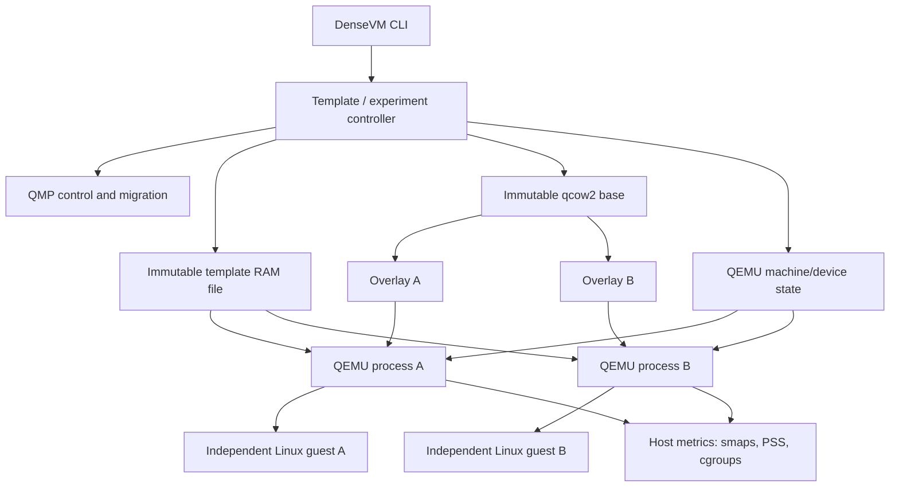

# DenseVM architecture

DenseVM keeps one QEMU process per guest and shares only state that is
immutable at the template boundary. QEMU owns and restores the mutable CPU and
device state. The host kernel supplies file-backed page sharing and
copy-on-write (COW); qcow2 supplies disk overlays.

## System view



The shared edges are read-only inputs. Each QEMU process has private execution
state and each guest gets a private overlay. Once a clone writes a shared RAM
page, Linux gives that process a private copy. A disk write goes into the
clone's overlay. Neither write changes the source template or sibling clone.

## Main runtime paths

### Conventional baseline

`densevm benchmark baseline` starts N separate ordinary QEMU guests from
equivalent disks. It records time until the guest `READY` marker, process
memory, idle CPU ticks, a bounded active CPU workload, disk allocation, host
capabilities, and optional TCG translation traces. This is the comparison
baseline; it does not share a frozen RAM template.

### Two-clone COW experiment

`densevm probe` is the central experiment. At a high level it:

1. checks host support and memory budget;
2. prepares a synthetic guest or an explicitly supplied supported guest;
3. creates an immutable qcow2 base;
4. starts a source QEMU with file-backed writable RAM and boots to readiness;
5. QMP-stops the source, verifies the stopped state, and migrates machine/device
   state using QEMU's migration machinery with `x-ignore-shared`;
6. freezes the source RAM and base disk as template artifacts;
7. creates a small qcow2 overlay per clone;
8. starts a separate QEMU for each clone, maps the RAM file privately, and
   restores the machine state;
9. prepares per-clone identity before NIC attachment;
10. probes RAM, disk, identity, process/liveness, optional crash/reboot/parking,
    and memory counters; and
11. writes a machine-readable JSON record with QEMU commands and host data.

The detailed orchestration is in [`src/probe.rs`](src/probe.rs). QEMU command
construction is also there; persistent clone launch and validation are in
[`src/launcher.rs`](src/launcher.rs). QMP framing and command handling are in
[`src/qmp.rs`](src/qmp.rs).

## RAM sharing model

The template QEMU maps a RAM file as a shared writable backend while it is
being built. After migration and shutdown, DenseVM treats that file as
immutable. A clone receives the same path through QEMU's file-backed memory
backend configured with `share=off`, `readonly=on`, and `rom=off`. The clone
must still see guest-writable RAM, so the kernel mapping is private and
writable (`rw-p` in `/proc/<pid>/smaps`): reads can use the same page-cache
page, while the first guest write faults in a private page.

```text
template RAM file page P
    ├── clone A mapping: P until A writes, then private P_A
    ├── clone B mapping: P until B writes, then private P_B
    └── clone C mapping: P until C writes, then private P_C
```

The RAM file is not a live shared-memory channel between guests. It is a
read-only common ancestor after freeze. DenseVM verifies the clone mapping
permissions and uses its exact path to isolate the mapping counters from all
other process memory.

## Machine state and migration

RAM is only one part of a running machine. QEMU migration transfers supported
mutable state, including vCPU architectural state and registered device state.
DenseVM does not define private serializers for QEMU structs. The source and
destination must use a compatible QEMU version, machine type, CPU model,
memory size, vCPU count, and device graph.

`x-ignore-shared` tells the migration path to omit RAM that is already present
in the shared backing object. It is experimental and must be detected at
runtime. A successful migration status alone is not enough: the restored guest
must run and pass RAM/disk/identity checks.

The current probe supports `--vcpus 1..4` and uses the same number for the
conventional baseline, source template, and restored clones. Two-vCPU restore
has passed twice. The current HMP register sampler returns `CPU#0` only, so it
does not yet directly inspect vCPU 1's architectural state.

## Disk sharing model

```text
read-only base.qcow2
    ├── clone A.qcow2: private changed clusters for A
    ├── clone B.qcow2: private changed clusters for B
    └── clone C.qcow2: private changed clusters for C
```

The base disk stores common blocks. Each clone's qcow2 overlay stores its
changes and points back to the base. `qemu-img info --backing-chain` verifies
the relationship. A clone must not open the base as a writable disk. Moving or
deleting a base invalidates its children unless the chain is relocated and
validated together.

## Identity and network gate

Migration can copy identity-bearing guest state. DenseVM generates unique host
machine IDs and locally administered unicast MAC addresses. The guest prepares
fresh entropy, reseeds its kernel RNG, updates machine identity/hostname, and
the prepared Alpine profile rotates OpenSSH host keys and sets a distinct DHCP
client identifier before the NIC is attached. A VMGenID device signals a
generation change; it does not promise that every userspace process rotates
cached random state or credentials.

Network attachment is a deliberate gate. Do not expose a clone to a shared
network until the guest identity workflow for that exact distro/profile has
completed. The identity evidence is specific to the tested Alpine/BusyBox
profile.

## QMP and lifecycle

Each VM has its own QMP Unix socket and serial socket. QMP is used to stop and
resume guests, verify status, configure migration capabilities, start incoming
migration, query machine identity, and request shutdown. Serial output is used
for guest protocol and readiness; QEMU's terminal output is not scraped as a
control protocol.

Persistent clones have registry records and explicit `start`, `stop`,
`reconcile`, and `delete` commands. Records include process fingerprints so a
reused PID is not mistaken for the original VM. Stop waits for both QMP closure
and process exit. Delete refuses live or ambiguous processes and only removes
paths inside that clone's directory. Hierarchical template generation is an
experimental Python workflow with hashed manifests and relative v4 lineage;
it is not yet a full persistent template manager.

`densevm template gc-plan ROOT --state-dir DIR [--keep GENERATION_ID]` reads
the existing clone registry without changing it, validates every generation,
marks explicit keeps and starting/running clone generations, then protects
their local ancestors. It reports unmarked generations and candidate leaves
as a dry run. Any integrity failure, duplicate ID, broken local parent link,
cycle, or unresolved clone reference blocks all candidates. There is no
template deletion command yet.

## Measurement path

`src/metrics.rs`, `src/inspect.rs`, and `src/report.rs` collect or summarize:

- process RSS and PSS from `/proc/<pid>/smaps_rollup`;
- shared/private clean and dirty pages;
- exact RAM-file mapping counters from `/proc/<pid>/smaps`;
- cgroup-v2 `memory.current` and `memory.stat` when available;
- qcow2 allocated storage and backing chains;
- process CPU scheduler ticks while idle and under a bounded guest workload;
- clone startup/resume time and guest-visible workload outputs;
- optional KSM counters and TCG trace events.

PSS apportions resident shared pages across mappings; it is better than adding
RSS for a sharing comparison, but it is not all host memory. KVM allocations,
kernel page tables, some page-cache pages, and memory outside the chosen
cgroup may not be included. Reports state these limits rather than treating
configured RAM as physical usage.

## Separate research branches

- **KSM:** optional post-hoc deduplication of equal pages. It is distinct from
  template COW and remains without a positive sample because the current user
  cannot change host-global `/sys/kernel/mm/ksm/run`.
- **TCG:** software translation traces measure translation activity. KVM does
  not use TCG translated blocks. Sharing generated code across QEMU processes
  is deferred because TBs can depend on CPU state, addresses, helpers, and
  invalidation state.
- **Parking:** explicit QMP pause reduces idle host CPU but changes guest time
  and timer semantics. It is not equivalent to continuously running hardware.

For experiment status and evidence, see [reports.md](reports.md) and
[progress.md](progress.md). For a beginner-friendly explanation of the
mechanisms, see [explanation.md](explanation.md).

